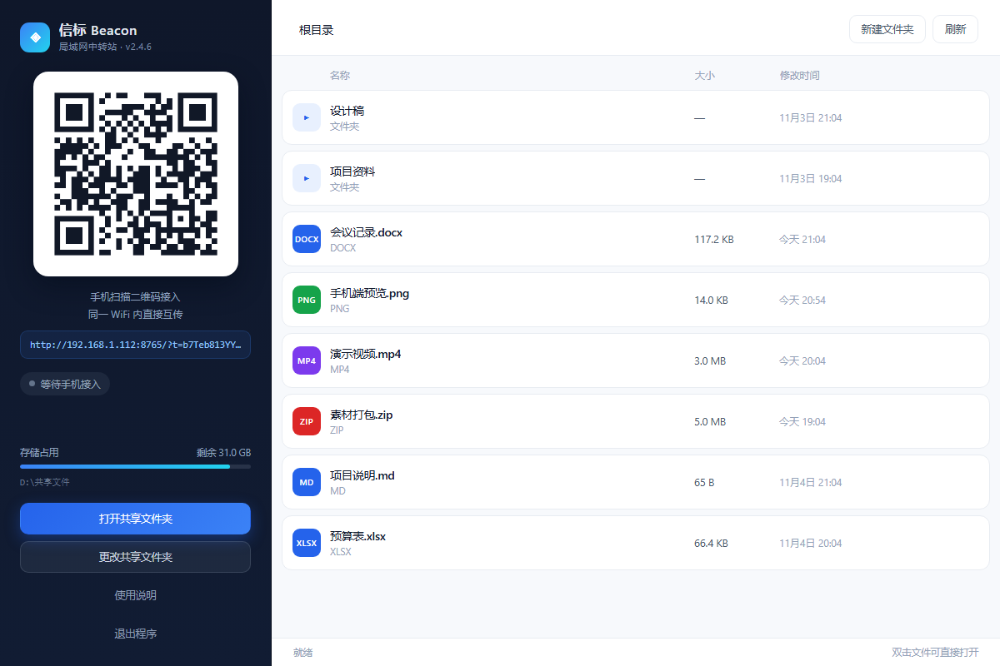
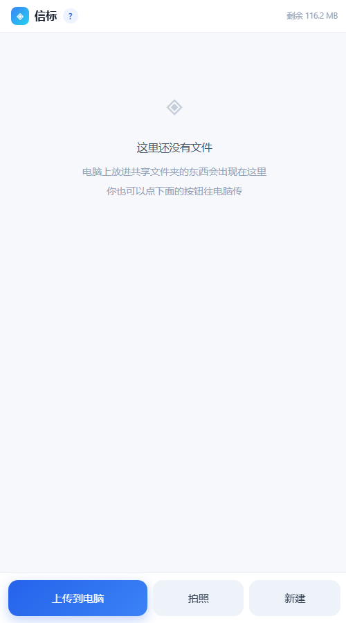
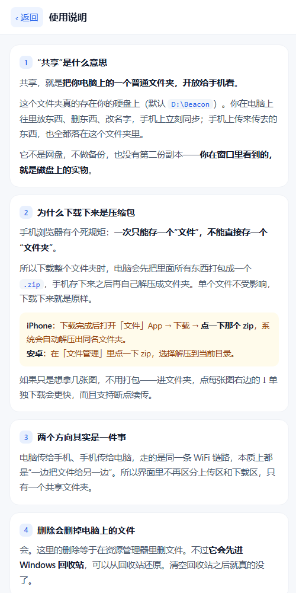

# 信标 Beacon

> **作者**：陈星瑜 · 四川科技职业学院 计算机应用技术
> **仓库**：https://github.com/17378757795/beacon

局域网内的文件中转工具。运行后在本机启动一个 HTTP 服务并生成二维码，手机扫码即可通过浏览器访问该服务，完成文件的上传与下载。

数据仅在局域网内传输，不经过第三方服务器，不需要注册账号，也不依赖互联网。

---

## 背景

在同一个局域网内传输文件，常见做法是借助即时通讯工具或网盘，但前者会压缩图片、限制大文件速度，后者需要上传到外部服务器并受容量与时效约束。

本项目采用另一种方式：由电脑端在本地提供 HTTP 服务，手机端作为客户端访问。文件始终保存在电脑的磁盘上，传输过程只发生在两台设备之间。

二维码中承载的内容是一行地址，格式为 `http://<局域网 IP>:<端口>/?t=<访问令牌>`，用于免去手动输入 IP 地址的步骤。

---

## 界面

电脑端主界面：



手机端（浏览器访问）：



内置使用说明：



> 若图片未能显示，是部分网络环境下 GitHub 图片加载受限所致，可直接查看 [screenshots](screenshots) 目录中的原图。

---

## 功能

**电脑端**

- 展示二维码、连接状态与磁盘占用
- 实时文件列表，与共享目录保持一致
- 支持拖拽文件或文件夹上传，自动保留目录结构
- 支持重命名、删除、新建文件夹，以及调用系统程序打开文件
- 删除操作将文件移入 Windows 回收站，可从回收站恢复
- 共享目录可在运行时切换，无需重启
- 显示当前连接的手机数量

**手机端**

- 扫码即用，无需安装应用；也可添加至主屏幕以全屏方式打开
- 图片显示缩略图，支持直接查看图片、视频与文本，无需先行下载
- 上传时显示实时速率与剩余时间；超过 6 MB 的文件自动分片，单片失败自动重传
- 单个文件下载支持断点续传
- 文件夹可打包为 ZIP 下载，打包过程边压边发，不产生临时文件

**访问控制**

- 每次启动生成随机访问令牌，二维码中包含该令牌
- 无令牌访问与目录穿越请求一律返回 403
- 上传文件名经过清洗，写入范围限制在共享目录内

---

## 技术结构

```
┌─────────────────────┐        HTTP / 局域网        ┌──────────────────┐
│  电脑端 Beacon.exe  │ ◄─────────────────────────► │  手机浏览器      │
│  Flask + Waitress   │                             │  扫码访问        │
│  共享目录 ↔ 磁盘    │                             └──────────────────┘
└─────────────────────┘
```

| 组成 | 说明 |
|---|---|
| 后端 | Python 3 + Flask + Waitress，单进程同时处理 HTTP 请求与窗口生命周期 |
| 窗口 | pywebview（EdgeChromium 内核），窗口关闭时进程随之退出 |
| 二维码 | qrcode 库生成，内容为本机局域网地址与访问令牌 |
| 前端 | 原生 HTML/CSS/JavaScript，未使用框架 |

---

## 快速开始

### 直接运行

双击 `dist\Beacon.exe`。首次运行时 Windows 可能弹出防火墙提示，需要选择「允许访问」，否则手机端无法连接。

默认共享目录为 `C:\Users\Public\Beacon`，可在窗口中点击「更改共享文件夹」切换为任意目录。若目标目录中已有文件，切换后立即生效，无需复制。

### 从源码运行

```bash
pip install -r requirements.txt
python app.py
```

### 打包

```bash
build.bat
```

---

## 接口

| 方法 | 路径 | 说明 |
|---|---|---|
| GET | `/` | 手机端页面，首次访问需携带 `?t=token` |
| GET | `/desk` | 电脑端窗口页面，仅本机可访问 |
| GET | `/help` | 使用说明 |
| GET | `/api/list` | 列出目录 |
| POST | `/api/upload` | 上传文件，支持多文件 |
| POST | `/api/upload/init` | 分片上传：初始化 |
| POST | `/api/upload/chunk` | 分片上传：上传单片 |
| POST | `/api/upload/finish` | 分片上传：合并 |
| GET | `/f?p=&inline=1` | 下载或预览，支持 Range |
| GET | `/zip?p=` | 文件夹打包下载 |
| GET | `/api/thumb` | 图片缩略图 |
| POST | `/api/delete` | 删除文件或目录 |
| POST | `/api/rename` | 重命名 |
| POST | `/api/mkdir` | 新建文件夹 |
| GET | `/api/qr.png` | 二维码图片 |
| GET | `/api/health` | 健康检查 |

---

## 实现说明

**局域网地址获取**：向 `8.8.8.8:80` 创建 UDP 套接字（不实际发送数据包），读取 `getsockname()` 获取本机出口地址。相比遍历网卡，该方式不会误选虚拟网卡。

**分片上传**：超过 6 MB 的文件按 2 MB 切片，每片独立重试。服务端预先创建目标文件并按片偏移写入，全部接收完成后才重命名为正式文件，中途中断不会残留不完整文件。

**打包下载**：使用 zipfile 的存储模式，配合后台线程与队列实现流式输出。生产者线程负责压缩，消费者将数据块写入 HTTP 响应，内存占用保持在数 MB 级别，且不在磁盘生成临时文件。

**窗口管理**：早期版本以浏览器的应用模式作为窗口外壳，存在一个问题——浏览器会复用同一个应用窗口，重复启动时旧页面被替换，触发关闭回调并终止服务。改用 pywebview 后，窗口归属于进程本身，关闭窗口即退出，行为可预期。

---

## 限制说明

- 仅在同一个局域网内可用。手机使用移动数据时无法访问，这是网络结构决定的。
- 传输使用 HTTP 明文。请求携带随机令牌，未持有令牌者无法访问，但内容本身未加密。在公共网络环境下存在被同网段抓包的可能。
- 超过约 1.2 GB 的文件夹在打包下载时采用流式输出，不支持断点续传；单个文件下载支持续传。
- 手机之间无法直接互传，需要经由电脑中转。

---

## 作者

陈星瑜

## 许可

本项目采用 MIT 许可证，详见 [LICENSE](LICENSE)。
